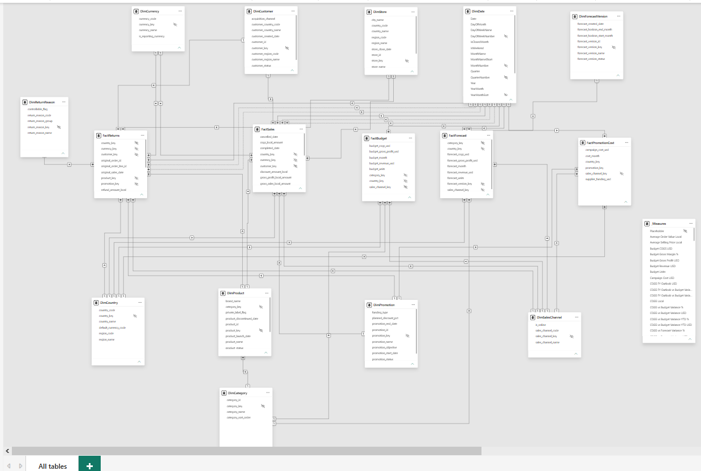
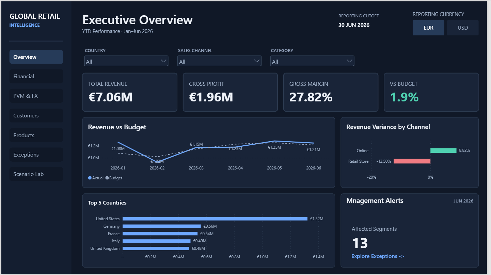
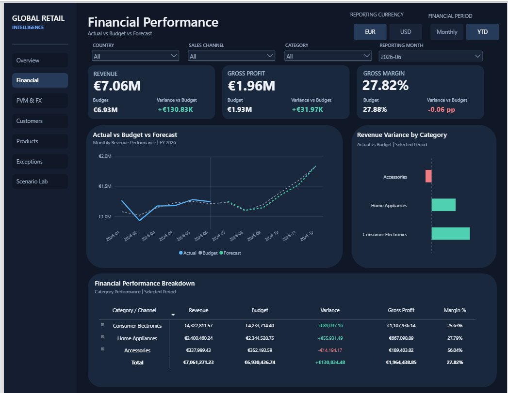
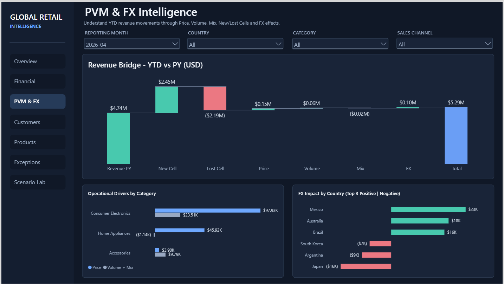
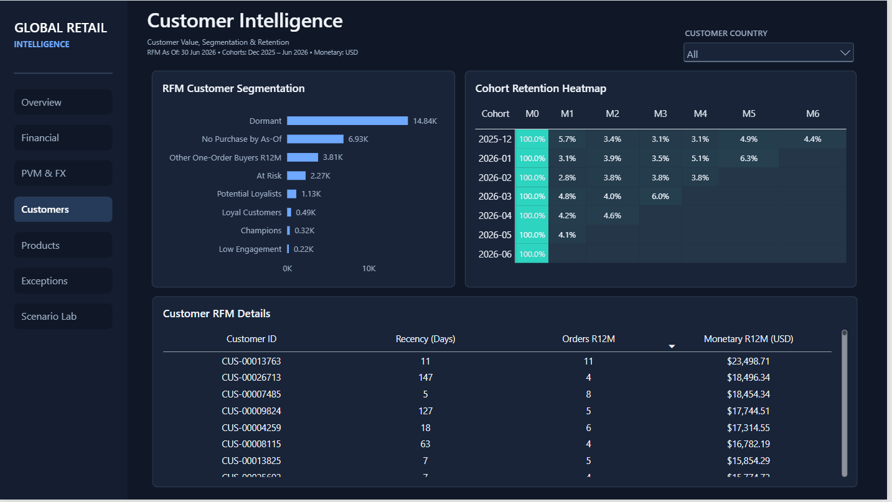
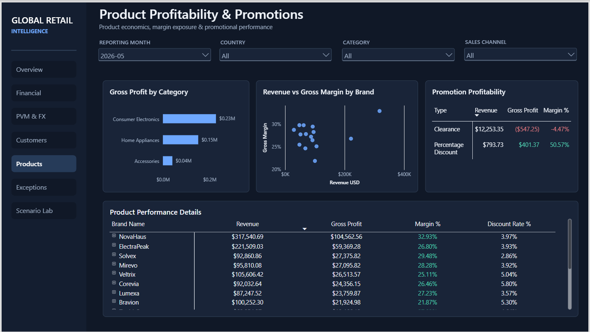
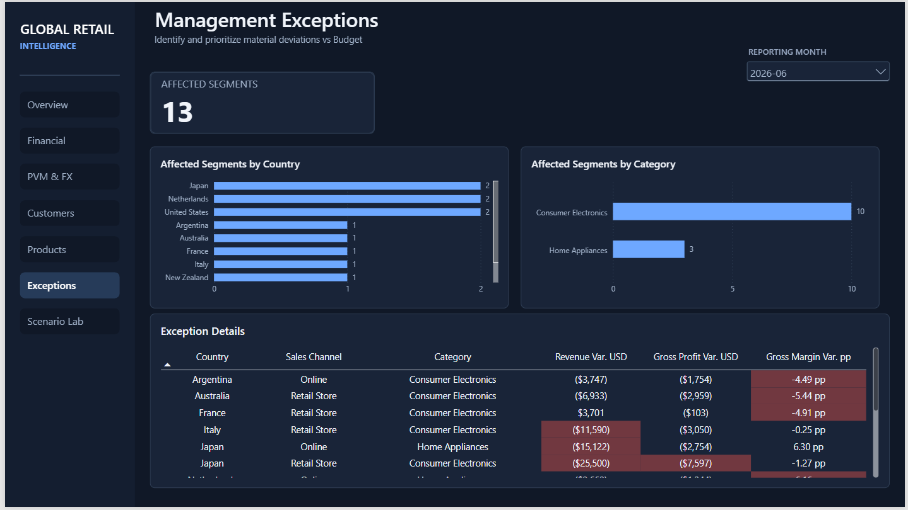
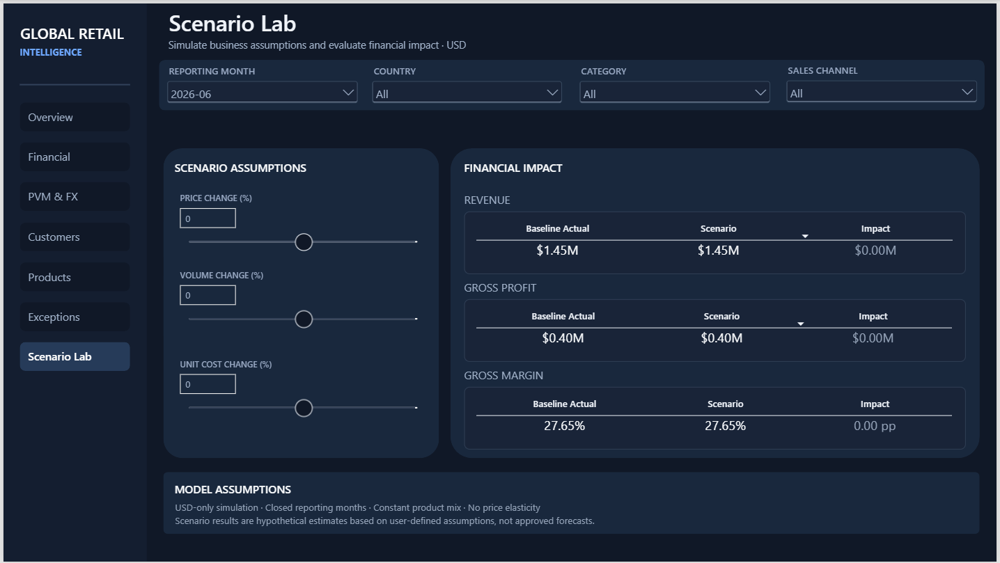
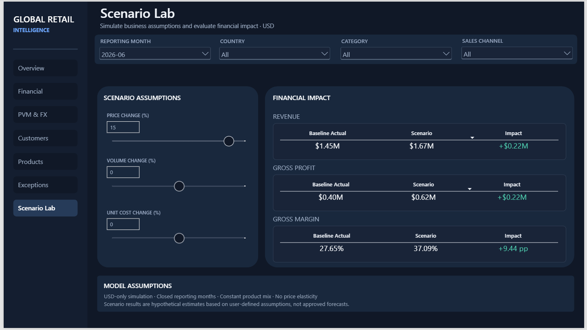

# Global Retail Performance & Financial Intelligence

**End-to-End Business Intelligence | PostgreSQL · Power BI · SQL & DAX · MCP · GitHub Copilot**

An end-to-end Business Intelligence portfolio project connecting a **locally developed PostgreSQL analytical data layer** with **Power BI financial and operational reporting**. Advanced DAX, dimensional modeling, and AI-assisted engineering workflows turn retail data into an interactive decision-support experience.

**30 tables · 35 relationships · 162 DAX measures · 1 Power BI report · 7 report pages**


*An interactive walkthrough of the finished Power BI report.*

[Watch or download the full Power BI report walkthrough (MP4)](Screenshots/Project_video.mp4)

## The business challenge

Retail performance is more than sales growth. Decision-makers need to understand **profitability, budget deviations, pricing and volume effects, customer behavior, and currency movements**—and to explore what could happen when assumptions change.

This project brings those questions together in one analytical report:

- How do revenue, gross profit, and gross margin develop over time?
- How do actual results compare with budget and forecast?
- What drives revenue changes: **price, volume, mix, or FX**?
- Which customers, products, and segments warrant attention?
- What is the potential financial impact of alternative business scenarios?

## From PostgreSQL to Power BI

```text
Retail source data
    ↓
PostgreSQL raw → SQL staging → SQL analytics
    ↓
Power Query → Power BI semantic model (Import Mode)
    ↓
DAX business measures → Interactive Power BI report
```

The data foundation was developed in **local PostgreSQL**, with distinct raw, staging, and analytics layers. SQL prepares analytical datasets upstream; Power Query imports the prepared data into Power BI, where the semantic model provides relationships, filter behavior, and reusable business measures.

### Technology stack

| Area | Technology | Role |
| --- | --- | --- |
| Database & analytical data layers | **PostgreSQL** | Raw, staging, and analytics data organization |
| Data transformation | **SQL** | Preparation of business-ready analytical datasets |
| Data integration | **Power Query** | Data loading into Power BI |
| Semantic modeling & reporting | **Power BI (Import Mode)** | Data model and interactive seven-page report |
| Analytical calculations | **DAX** | Financial, customer, and scenario analysis |
| Development, QA & optimization | **VS Code, MCP, GitHub Copilot** | Model inspection, DAX queries, debugging, and validation |

### Semantic model

The model contains **30 tables, 35 relationships, and 162 DAX measures**. Its design emphasizes dimensional modeling, clear table grain, and primarily single-direction filtering. The model also includes supporting and disconnected tables for report controls and what-if parameters; it is **not** presented as 30 dimensions and facts in a single star.



*The Power BI semantic model uses analytical datasets prepared in the local PostgreSQL environment. Relationships and DAX calculations are managed in Power BI.*

## Explore the report

The report uses a consistent **Midnight Analytics v1.1** design system across seven interactive pages.

### 01 · Executive Overview

A management-level snapshot of commercial and financial performance, bringing key indicators and interactive reporting controls into one entry point.



### 02 · Financial Performance

Compares **Actual, Budget, and Forecast** to help investigate variances and understand the financial outlook.



### 03 · Price–Volume–Mix & FX

Explains revenue movements through **price, volume, and mix**, alongside a separate view of foreign-exchange impact.



### 04 · Customer Intelligence

Supports customer-value analysis with **RFM segmentation** and customer behavior measures, building on the project's broader cohort and retention analytics.



### 05 · Product Profitability & Promotions

Investigates product and category contribution through revenue, gross profit, gross margin, and promotion-related views.



### 06 · Management Exceptions

Surfaces material deviations from budget using rule-based measures and explicit safeguards around reporting periods and supported analytical context.



### 07 · Scenario Lab

Provides interactive **what-if simulation** so report users can adjust business assumptions and see the resulting impact on revenue, gross profit, and gross margin.

**Baseline (0% adjustments)**



**Adjusted scenario**



*The scenario changes are simulated in DAX; they do not overwrite source data.*

## Advanced analytics

The model goes beyond standard KPI reporting with **Actual vs Budget vs Forecast**, period comparisons, **Price–Volume–Mix**, **FX impact**, **RFM and cohort analysis**, profitability, dynamic **Top-N with Others**, management exceptions, and scenario simulation.

The calculations were designed around explicit **filter context, reporting grain, reusable measures, and closed-period controls**, rather than treating every calculation as a visual-level expression.

## MCP & GitHub Copilot: AI-assisted BI engineering

**Model Context Protocol (MCP)** integrations and **GitHub Copilot** supported the technical development process—not the production data pipeline. Their practical applications included:

- Inspecting semantic-model metadata, measures, dependencies, and relationships.
- Executing targeted **DAX queries** to test calculations in controlled filter contexts.
- Troubleshooting complex measure logic and investigating performance bottlenecks.
- Supporting iterative QA and validation before publication to **Power BI Service**.

The architecture, business rules, and acceptance of results were governed by explicit requirements and verification—not by treating AI-generated suggestions as automatically correct.

## Quality, performance & design decisions

- **Layered SQL architecture:** separate raw data from prepared analytical datasets.
- **Import Mode:** favor responsive interactive analysis.
- **Controlled relationships:** prioritize clear table grain and single-direction filter flow.
- **Reporting safeguards:** handle incomplete periods and unsupported comparison contexts explicitly.
- **Power BI Service QA:** validate behavior beyond Power BI Desktop, including resource-sensitive visuals.

## Repository & usage

This repository intentionally focuses on the finished portfolio presentation:

- `README.md` — project narrative, architecture, and report showcase.
- `Screenshots/` — report walkthrough, page captures, and semantic-model illustration.
- Power BI `.pbix` — report and semantic model.

The Power BI report can be explored in **Power BI Desktop**. Refreshing the data requires access to the corresponding PostgreSQL environment. The full database deployment and SQL pipeline are **not** included in this showcase repository.
---

*Built as an end-to-end BI portfolio project combining PostgreSQL data preparation, Power BI semantic modeling, advanced financial analytics, and MCP-assisted development workflows.*
